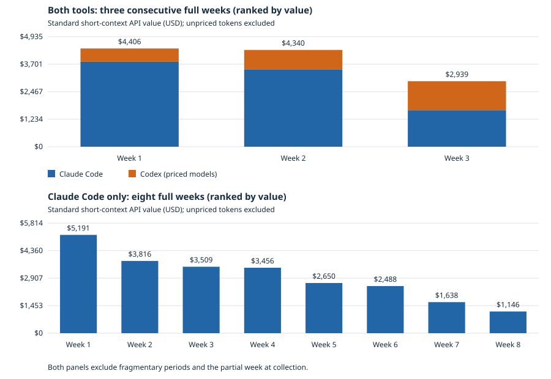

## Both tools: three consecutive full weeks

Both tools have full retained records for **three consecutive full weeks**. Their combined priced value is **$11,684.41**, with a **median of $4,340.05 per week** and a **mean of $3,894.80 per week**. This window contains **44,195,194,919 recorded tokens**, including **4,432,888,344 unpriced tokens**. Unpriced usage is excluded from dollar amounts throughout.

| Ranked week | Claude Code (USD) | Codex priced (USD) | Combined priced (USD) |
| --- | --- | --- | --- |
| Week 1 | $3,816.11 | $589.70 | $4,405.81 |
| Week 2 | $3,456.47 | $883.58 | $4,340.05 |
| Week 3 | $1,638.46 | $1,300.10 | $2,938.56 |

The top chart panel shows these three weeks. The lower panel shows the separate Claude-only window; it does not treat missing Codex records as zero use. The [weekly CSV](https://github.com/techczech/model-data-points/blob/main/data/2026-11-17-coding-agent-token-usage-weekly.csv) lists each window separately, ranked by value in descending order. Week labels are ranks within each window, not calendar positions; the two panels do not share week identities.

## Claude Code only: eight full weeks

The secondary window includes **eight full weeks of Claude Code records**, with a **median of $3,053.03 per week**. Claude's earlier default 30-day log cleanup left sparse records before retention was increased. Codex was in use before its first retained record, so this longer window makes no claim about combined usage.

| Ranked week | Claude Code (USD) |
| --- | --- |
| Week 1 | $5,190.82 |
| Week 2 | $3,816.11 |
| Week 3 | $3,509.05 |
| Week 4 | $3,456.47 |
| Week 5 | $2,649.59 |
| Week 6 | $2,488.30 |
| Week 7 | $1,638.46 |
| Week 8 | $1,145.51 |

## Models: three consecutive full weeks

| Logged model | Tokens (including cached) | Priced value (USD) |
| --- | --- | --- |
| claude-opus-5-5 | 15,525,489,710 | $6,518.16 |
| gpt-6.1-sol | 15,494,022,582 | $2,640.97 |
| claude-sonnet-5-5 | 6,673,872,997 | $1,561.94 |
| claude-fable-5-2 | 1,516,052,891 | $819.32 |
| gpt-6-astra | 77,608,081 | $107.25 |
| gpt-6.1-terra | 320,864,634 | $24.40 |
| claude-fable-5-1 | 5,085,357 | $6.82 |
| claude-haiku-5-5 | 111,929,343 | $4.79 |
| gpt-6-luna | 37,380,980 | $0.77 |
| codex-auto-review | 4,432,888,344 | Unpriced |

## Token types: three consecutive full weeks

Each row is a disjoint billing category. Cache value means cache reads plus writes and Codex cached input, divided by priced value: **$8,774.89 / $11,684.41 = 75.10%**. It is the value assigned to cached categories, not a claim about money saved.

| Tool | Token type | Tokens | Priced value (USD) | Unpriced tokens |
| --- | --- | --- | --- | --- |
| claude | Uncached input | 1,378,158 | $8.39 | 0 |
| claude | Output | 105,139,921 | $1,732.92 | 0 |
| claude | Cache reads | 23,234,405,475 | $3,979.46 | 0 |
| claude | Cache writes, 5 minutes | 103,615,078 | $440.94 | 0 |
| claude | Cache writes, 1 hour | 387,891,666 | $2,749.34 | 0 |
| codex | Uncached input | 601,994,998 | $641.70 | 281,025,907 |
| codex | Output | 55,821,143 | $526.52 | 4,025,509 |
| codex | Cached input | 19,704,948,480 | $1,605.16 | 4,147,836,928 |
| codex | Cache writes (none recorded) | 0 | $0.00 | 0 |

The [full-record model/token-type CSV](https://github.com/techczech/model-data-points/blob/main/data/2026-11-17-coding-agent-token-usage-full-record-model-token-types.csv) gives the complete tool × model × token-type split for the three consecutive full weeks, including separate cached categories. The [all-retained model/token-type CSV](https://github.com/techczech/model-data-points/blob/main/data/2026-11-17-coding-agent-token-usage-model-token-types.csv) includes fragmentary periods and the current partial week. Blank prices and values mean unpriced, not free. Weekly and token-type dollar totals sum priced models only.

## Pricing and reconstruction

All rates are USD per million tokens, checked **17 November 2026**. The [rate CSV](https://github.com/techczech/model-data-points/blob/main/data/2026-11-17-coding-agent-token-usage-prices.csv) records each model, token type, rate, source URL and check date. Claude prices come from [Anthropic's model pricing](https://platform.claude.com/docs/en/about-claude/pricing). OpenAI prices come from the official model pages for [Sol](https://developers.openai.com/api/docs/models/gpt-6.1-sol), [Terra](https://developers.openai.com/api/docs/models/gpt-6.1-terra), [Astra](https://developers.openai.com/api/docs/models/gpt-6-astra) and [Luna](https://developers.openai.com/api/docs/models/gpt-6-luna).

Claude cache writes use 1.25 times input for five-minute retention and twice input for one-hour retention. When the logs omit that split, the collector assigns the aggregate creation count to five-minute writes. No Codex cache writes were recorded. Haiku 4.5's dated ID maps to the public Haiku 4.5 rate. No other older models appear.

The checked Fable 5.1 cache-read rate is **$0.25 per million**. Across all retained logs, using $1 instead, as in the initial pricing brief, would add **$731.90**, bringing that secondary total to **$30,911.14**. All reported values use the checked public price.

The label `codex-auto-review` accounts for **4,432,888,344 unpriced tokens in the three-week headline window** and **5,009,145,259 across all retained logs**. No public API price was found for that exact label on the pricing or model pages checked. OpenAI [describes auto-review](https://alignment.openai.com/auto-review/) as a separate approval agent; that does not establish the underlying model for these records, so no substitute model price is assigned.

The public reconstruction inputs are ranked, undated weekly values and whole-window model/token-type totals. Run `python3 scripts/value-coding-agent-usage.py` to regenerate the derived CSVs, chart and this entry, then `uv run scripts/build-site.py` to build the page. The collector is supplied for inspecting the method; it reads local logs and should not be used to publish its unsanitised JSON output. Fresh daily inputs remain in ignored local storage; public outputs contain only ranked, undated weeks and whole-window totals. Folders, entrypoints, origins, project paths and session content are excluded.
